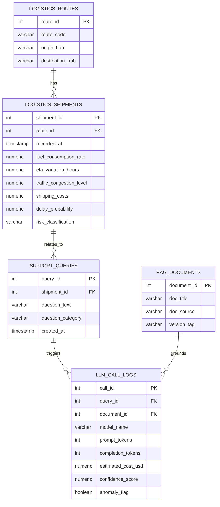

# Vize Projesi - Veritabanı Yönetim Sistemleri 

*Öğrenci Adı Soyadı: Elif Azra Yılmaz 
*Öğrenci Numarası: 202607131001
*Program: Yapay Zeka Operatörlüğü
*Senaryo Kura: Kura#2 (Lojistik ve teslimat , RAG bilgi asistanı , LLM çağrı kayıtları ve maliyet)

# Çalıştırma Adımları :
Bu proje hafta 3-5 vize kurallarına ve konusuna göre hazırlanmıştır.

## Veri Modeli

### 2.1 Güncel ERD

### 2.2 Normalizasyon notu

| Tablo | Ayrıldı mı / Neden ayrıldı veya ayrılmadı? | Form | Somut Örnek |
|---|---|---|---|
| `LOGISTICS_ROUTES` ve `LOGISTICS_SHIPMENTS` | Tek `logistics_data` kaydındaki rota çıkış/varış noktaları ile sevkiyat/risk/maliyet sütunları tekrarlanmasın diye rota bilgisi `LOGISTICS_ROUTES` tablosuna ayrıldı; `shipment_id` tüm sütunları tekil belirler. | 3NF | `route_id` (`1`) `origin_hub` ve `destination_hub` değerini belirler; `shipment_id` dışındaki sütunlar birbirine bağımlı değildir. |
| `SUPPORT_QUERIES` | Müşteri sorusu metni, kategori ve zaman damgası `query_id` anahtarına doğrudan bağlıdır; tekrarlayan gruplar veya geçişli bağımlılıklar yoktur. | 3NF | `query_id` (`101`) doğrudan `"Where is my package?"` metnini ve `"teslimat"` kategorisini belirler. |
| `RAG_DOCUMENTS` | Kaynak doküman başlığı ve sürüm bilgisi her LLM çağrısında tekrarlanmasın diye `RAG_DOCUMENTS` tablosuna ayrıldı; `document_id` sütunları tekil tanımlar. | 3NF | `document_id` (`12`) doğrudan `"İade Politikası v3"` başlığını belirler; `doc_title` başka bir sütunu belirlemez. |
| `LLM_CALL_LOGS` | Her çağrının token sayısı, maliyeti, güven skoru ve anomali bayrağı `call_id` anahtarına bağlıdır; maliyet hesabı kayıt anındaki birim maliyetle saklanır. | 3NF | `call_id` (`501`) doğrudan `prompt_tokens` (`420`) ve `estimated_cost_usd` (`0.0018`) değerini belirler. |

* **1NF örneği:** `SUPPORT_QUERIES` tablosunda `question_text` tek bir metin değeri taşır; birden fazla soruyu virgülle tek hücreye yığmak yerine her soru ayrı satırda tutulur.
* **2NF örneği:** Tek sütunlu birincil anahtar (`shipment_id`, `query_id`, `call_id`) kullanıldığı için kısmi anahtar bağımlılığı oluşmaz; örneğin `LOGISTICS_SHIPMENTS` içindeki `shipping_costs` ve `delay_probability` doğrudan tek bir sevkiyat kaydına aittir.
* **3NF örneği:** Rota çıkış/varış bilgisi (`origin_hub`, `destination_hub`) `LOGISTICS_SHIPMENTS` içinde tutulmak yerine `LOGISTICS_ROUTES` tablosuna ayrılarak anahtar dışı geçişli bağımlılıklar önlenmiştir.

### 2.3 İki JOIN sorusu

1. **INNER JOIN sorusu:** Her RAG yanıt çağrısı için kullanılan model adını, tahmini maliyeti, güven skorunu ve ilgili müşteri sorusu metnini listeleyin.
   * **Birleşecek tablo ve sütunlar:** `LLM_CALL_LOGS.query_id = SUPPORT_QUERIES.query_id`
   * **JOIN türü ve nedeni:** `INNER JOIN` kullanılır; çünkü yalnızca geçerli bir müşteri sorusu kaydıyla eşleşen LLM çağrı kayıtları raporlanmak istenir.

2. **LEFT JOIN sorusu:** Tüm müşteri destek sorularını, varsa üretilen LLM çağrısının güven skoru ve anomali bayrağıyla birlikte; henüz LLM çağrısı oluşmamış soruları da `NULL` olarak listeleyin.
   * **Birleşecek tablo ve sütunlar:** `SUPPORT_QUERIES.query_id = LLM_CALL_LOGS.query_id`
   * **JOIN türü ve nedeni:** `LEFT JOIN` kullanılır; çünkü eşleşmeyen (`LLM_CALL_LOGS` kaydı olmayan) müşteri sorularının da listeden düşmeden görünmesi gerekir.